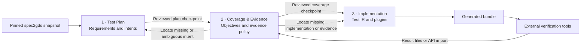
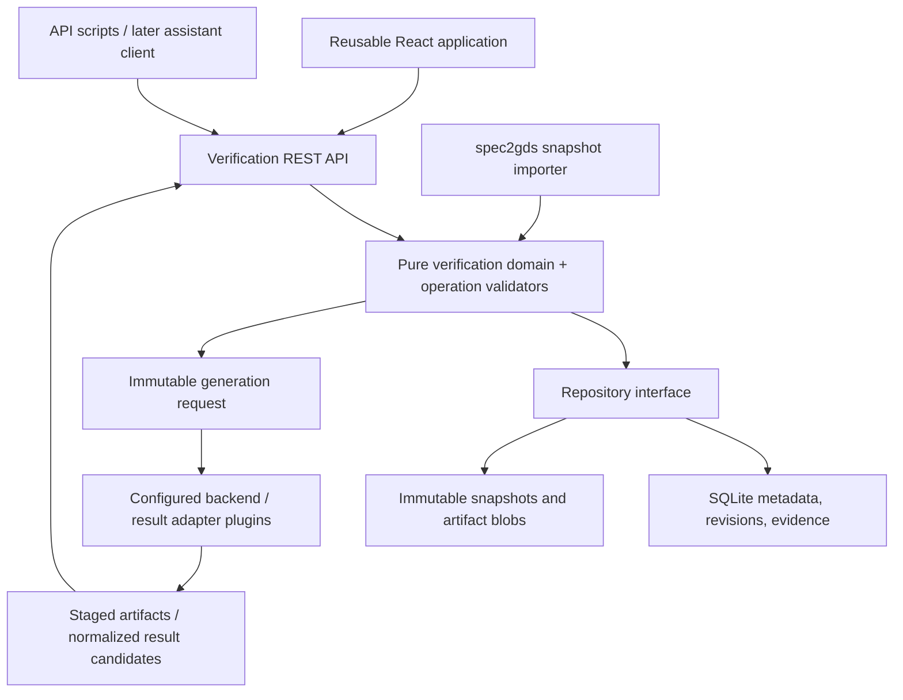

# Verification Planner — service and user experience specification

Status: implementation plan; no application behavior described here is claimed to exist.
Prepared 2026-09-27. This document and its three companions form one design contract.

## 1. Reading order and authority

1. This document: product boundaries, shared UX, architecture, persistence, API conventions, delivery gates.
2. [Layer 1 — Test Plan](verification-layer-1-test-plan.md): snapshot references, hierarchy, manually authored verification intent.
3. [Layer 2 — Coverage & Evidence](verification-layer-2-coverage.md): coverage objectives, traceability, results, gaps, closure.
4. [Layer 3 — Implementation](verification-layer-3-implementation.md): test IR, bindings, plugins, generation artifacts.

The shared contracts here apply to all layers. Each companion owns its domain fields and rules. A coding agent must implement these decisions rather than substitute a different product model. Any necessary change to a contract must first be recorded in these documents, with affected acceptance criteria updated. Language/library patch versions and private helper organization are implementation choices; ownership, behavior, visible labels, validation, and evidence semantics are not.

### Confirmed user decisions

| Topic | Decision |
| --- | --- |
| Existing prototype | Redesign freely; reference only; no migration requirement |
| Product | Independent service parallel to Spec Editor and Circuit Designer |
| Priorities | Human navigation and clarity first; complete UI/API parity |
| Inputs | Only spec2gds snapshots; no PDF/Word requirement extraction |
| Plan authorship | Users and scripts add sections and points explicitly |
| Three layers | Intent; coverage/evidence; implementation, with separate responsibilities |
| Coverage | Separate scope hierarchy and evidence-type dimensions |
| Team use | Small team, revision protection, explicit review checkpoints |
| Generation | Structured backend-neutral test IR; deterministic plugin interface |
| Backends | Design for Cocotb, UVM, and formal; concrete generators come later |
| Layout | Persistent hierarchy, central workspace, right details panel |
| Acceptance example | Synchronous FIFO and a design containing two FIFO instances |
| AI | Later client integration; no model or assistant runtime dependency |

### Design defaults selected for this proposal

These resolve remaining engineering choices; they are proposal decisions, not additional user confirmations.

- Product title **Verification Planner**; service/package name `testplan-service`; default port 6016.
- Service owns durable verification data independently of the `.spec` package.
- Import external results; no local/remote execution scheduler in the initial scope.
- Explicit Save for forms; explicit reviewed checkpoints for downstream consumption.
- Single-process SQLite storage plus immutable artifact files; portable bundle export.
- Python/FastAPI domain service; React/TypeScript application shell consistent with the other editors.
- Local/trusted small-team deployment; no account management or regulated approval workflow.
- Supported desktop width 1024 px; usable reduced layout from 720 px; no mobile authoring milestone.

## 2. Product objective and boundaries

A verification engineer must be able to open a design snapshot, write a hierarchical test plan, identify missing verification coverage, and prepare implementations without needing a chat assistant or reading generated code to understand the plan.

The product's three main tabs are **Test Plan**, **Coverage & Evidence**, and **Implementation**. They are workspaces, not a wizard: users can return to any tab at any time. A persistent selection and breadcrumb connect them. Review checkpoints provide stable inputs while upstream authors continue editing.

Deploy one verification service with three domain modules, not three mandatory network services. `domain.plan` has no import of coverage or implementation. `domain.coverage` reads immutable plan contracts and normalized evidence contracts, without importing a code generator. `domain.implementation` reads reviewed plan/coverage contracts, while result adapters emit the shared normalized evidence contract. Cross-layer summaries are application-level read projections, so adding coverage badges to the intent UI does not reverse the domain dependency direction. Layer 1 remains fully usable when no coverage has been authored; Layers 1 and 2 remain usable when no backend plugin is installed.

| Layer | Owns | Must not own |
| --- | --- | --- |
| Test Plan | Requirements selected from source; sections; behavioral intents; scope; expected behavior; source issues | Testbench code, simulator choice, coverage-bin definitions, execution outcomes |
| Coverage & Evidence | Objectives, bins, evidence policies, mappings, normalized evidence, gaps, closure reports | UVM classes, signal bindings, test generation, source interpretation |
| Implementation | Recipes/test IR, observation bindings, backend configuration, generated artifacts, result adapters | Changing expected behavior, declaring an intent satisfied, changing coverage denominators |

Use **intent** in normal UI language. An intent is the atomic verification obligation discussed in the reference PDF. Avoid a second parallel “obligation” record or making users learn two names for the same object.



No dependency arrow authorizes a downstream layer to mutate an upstream layer. A gap opens the relevant editor with context. The user makes a normal revision-checked edit there.

### Deliberate initial exclusions

No automatic requirement extraction, AI generation, conversational UI, autonomous closure loop, simulator scheduling, arbitrary document import, commercial simulator license management, real-time collaborative text editing, safety certification, automatic proof transfer between instances, or production Cocotb/UVM/formal backend implementation. The foundation must still contain the complete extension contracts and a deterministic reference plugin that exercises them.

## 3. Look, feel, and shared navigation

### 3.1 Visual identity

Use the existing [Blueprint Slate direction](circuit-designer-visual-profile.md), with a light reading surface. Long descriptions and tables are the primary content; minimize decorative cards and saturated backgrounds. The header is dark navy; the hierarchy and inspector are light neutral surfaces for sustained reading.

| Token | Value | Use |
| --- | --- | --- |
| `chrome` | `#081f33` | Top application header |
| `canvas` | `#f7f9fc` | Workspace background |
| `surface` | `#ffffff` | Reading/editing panels and dialogs |
| `surface-muted` | `#eef3f8` | Hierarchy and secondary sections |
| `text` | `#102a43` | Main text on light surfaces |
| `muted-text` | `#52667a` | Supporting labels |
| `border` | `#c8d3df` | Panel and table boundaries |
| `primary` | `#007c89` | Save and primary actions |
| `plan-accent` | `#1d64c8` | Test Plan tab/identity |
| `coverage-accent` | `#007c89` | Coverage tab/identity |
| `implementation-accent` | `#6550a1` | Implementation tab/identity |
| `success` | `#17653a` | Satisfied evidence with check icon |
| `warning` | `#895300` | Missing/stale/attention with triangle icon |
| `danger` | `#b42318` | Failed check/invalid input with cross icon |
| `neutral` | `#52667a` | Not evaluated/unconfigured with dash icon |
| `focus` | `#16709a` | Visible keyboard outline |

Layer colors identify locations, never progress. Use pale tinted fills with dark status text, always accompanied by a word and icon. “Mapped,” “Satisfied,” “Failed,” and “Waived” must remain distinguishable without color. Do not show a green tab because it contains a saved checkpoint.

Use system sans-serif, 14 px body, 13 px table text, 12 px minimum metadata, 20 px page titles, 16 px section headings. Body line-height 1.5. Spacing scale 4/8/12/16/24/32 px; borders 1 px; control radius 4 px; dialogs 8 px. Default row height 36 px, comfortable mode 44 px. No all-caps paragraph labels. Code identifiers use monospace only in technical detail sections.

Text/control contrast and keyboard focus must be measured in browser acceptance checks. Target at least 4.5:1 for body text and 3:1 for interactive boundaries/focus. Selection uses a border/indicator as well as background.

### 3.2 Shared shell

```text
┌ Verification Planner   FIFO subsystem ▾     Saved · r42      Help ┐
│ Test Plan       Coverage & Evidence       Implementation          │
│ fifo_pipeline / ingress / Boundary behavior / Full write          │
├──────────────────┬─────────────────────────────┬─────────────────┤
│ Find in hierarchy│ Layer toolbar + filters     │ Selected item   │
│                  │                             │                 │
│ fifo_pipeline    │ Outline / matrix / recipes  │ Summary         │
│  ingress         │                             │ Source          │
│   Reset          │ Main reading and editing    │ Related items   │
│   Boundaries     │ surface                     │ History         │
│    Full write ◀  │                             │                 │
│  egress          │                             │ Edit            │
│  Integration    │                             │                 │
├──────────────────┴─────────────────────────────┴─────────────────┤
│ 2 selected · 3 hidden by filter              Source: snapshot A  │
└──────────────────────────────────────────────────────────────────┘
```

- Header 48 px; layer tabs 44 px; breadcrumb 32 px; footer 28 px.
- Left panel starts at 272 px, resizable 220–400 px. Right panel starts at 352 px, resizable 300–480 px. Center gets remaining width and at least 440 px.
- At widths below 1280 px the inspector defaults to a dismissible drawer. Below 1024 px the hierarchy also becomes a drawer. Only the center scrolls vertically with its own sticky toolbar; panel scroll positions persist independently.
- At 720–1023 px keep tab names, selected item, Save, and navigation visible. Tables may scroll horizontally inside their pane; the page must not acquire horizontal overflow.
- The left hierarchy always represents source scope and Layer 1 sections/intents. Layer-specific counts can appear alongside it, but its structure does not become an implementation tree when tabs change.
- Top-level plan selector offers **New plan**, **Open plan**, **Import plan bundle**, **Export plan bundle**, **Plan settings**. Samples are explicit “Open example,” never automatically seeded.
- Search is local to the open plan, across titles, display keys, descriptions, and source labels. Results include scope paths and item types. Debounce 200 ms; Enter opens the selected result; Escape restores the preceding view.
- A secondary **Trace** view shows a bounded graph for the selected item, initially one hop in each direction. It must have an equivalent relationship table. Never make graph manipulation necessary for authoring.

### 3.3 Context and routes

Proposed browser routes:

| Route | View |
| --- | --- |
| `/plans` | Plan library |
| `/plans/:planId/plan?item=:id` | Layer 1 selected item |
| `/plans/:planId/coverage?item=:id&view=matrix` | Coverage matrix for current selection |
| `/plans/:planId/coverage?intent=:id&view=gaps` | Filtered gaps |
| `/plans/:planId/implementation?intent=:id&recipe=:id` | Implementations for intent |
| `/plans/:planId/reviews/:checkpointId` | Immutable reviewed snapshot |

Layer switching retains the selected scope/intent, filters applicable to that layer, and scroll position. A coverage objective or recipe has explicit **Back to intent** links. If a recipe spans multiple intents, switching to Test Plan offers its related-intent list; do not choose an arbitrary one. A deleted ID shows its archived record and nearest surviving ancestor. Browser Back/Forward restores selection. Copy link contains IDs, never server-local file paths or credentials.

### 3.4 Common interactions and feedback

- Single-click selects; disclosure arrow expands; double-click title enters editing only where an Edit control also exists.
- Each row has a visible context-menu button, available by keyboard. Core actions cannot exist only in a hover menu.
- Form edits remain local until **Save**; **Cancel** restores the saved version. Ctrl/Cmd+S saves the active form only. Leaving a dirty form offers **Save and continue**, **Discard**, **Stay**. Browser closing uses native unsaved-change protection and best-effort local draft recovery, never a silent server save.
- Add dialogs create no record until Save succeeds. After creation select the new item and focus its heading. “Add another” is available for repeated intent/objective entry.
- Reorder and move use an explicit **Move…** dialog with destination and before/after position; drag-and-drop is an optional equivalent. Invalid destinations are explained and disabled.
- Batch editing opens a preview showing the affected count, fields, and validation diagnostics. No partial success for one command batch.
- Save errors preserve all input. Validation focuses the first invalid field and also lists every error in a summary. The summary links to fields and names the affected item.
- Destructive actions show dependency counts. Archive preserves references/history; hard delete is allowed only for an unreferenced draft record. No cascading deletion of intents, evidence, or checkpoints.
- Standard states: loading skeleton; actionable empty state; saved; unsaved; saving; conflict; read-only checkpoint; disconnected with preserved input. Connectivity banners do not replace the whole page.
- API-driven updates arrive as events. A clean view refreshes; a dirty form receives **Newer version available** and keeps its input.
- Keyboard: arrows navigate tree; Right expands; Left collapses/parent; Enter selects; F2 edits selected editable title; Escape closes transient UI; Ctrl/Cmd+K opens search. Every command also has a visible menu/action.
- All dialogs trap focus and restore it on close; forms have labels; errors are announced; status updates use a polite live region; reduced motion removes transitions. No required action depends on drag, color, or hover.

## 4. User journey across layers

1. **New plan** → name → import spec2gds Activity Snapshot → choose component/design root. Preview snapshot identity, source revision, included entities. Save an empty plan bound to this source.
2. **Test Plan** → select source paragraphs/sections → capture requirements manually → create sections and intents. Save incomplete drafts freely, with visible unresolved fields.
3. **Review plan** → checklist and diff → explicit confirmation → immutable Plan checkpoint `P1`. Layer 2 can begin before this review, but its reviewed checkpoint must pin a reviewed Plan checkpoint.
4. **Coverage & Evidence** → matrix initially exposes “No objectives” per active intent → add objectives and evidence policies → resolve mapping holes → review Coverage checkpoint `C1` referencing `P1`.
5. **Implementation** → select intents/objectives → create recipe → configure target bindings and backend → review Implementation checkpoint `I1` referencing `C1` → generate supported output.
6. Run output in external tools; import result bundle or POST results. Inspect import preview, exact provenance, and unmapped observations before committing.
7. Layer 2 updates only the evidence view for the selected baseline/campaign. Clicking a failed or missing item opens the exact objective, related intent, source excerpt, and result.
8. Change source/intent/coverage/recipe using normal edits. Old checkpoints/results remain inspectable. New checkpoints require impact review; no automatic promotion of old evidence.

Reviews are lightweight engineering checkpoints, not a mandatory second-person approval. A named user may author and review their work. Review records contain actor, time, revision hashes, checklist results, and comment. There is no assertion of verified personal identity in local mode.

## 5. Architecture and ownership



### 5.1 Module boundaries

| Module | Responsibility | Forbidden dependency |
| --- | --- | --- |
| `domain` | Records, relationships, validation, metrics, operation interpreter | HTTP, React, AI, simulator APIs, spec2gds internals |
| `application` | Transactions, checkpoints, imports, generation jobs | Browser DOM or backend-specific test syntax |
| `storage` | SQLite repository and blob store | Changing domain semantics |
| `api` | REST, schema discovery, SSE, authentication adapter | Reimplementing domain validation |
| `integrations/spec2gds` | Decode/validate Activity Snapshot, expose source projection | Mutating source or core importing SpecIR |
| `plugins` | Registry, contracts, host-controlled execution | Direct database access by plugins |
| `ui` | Shared shell, domain forms, accessible views | Direct file/SQL mutation |
| `standalone` | Routes, service address, browser files/preferences | New domain rules |

Use a Python library/optional integration package for spec2gds parsing. A clean standalone install needs the snapshot decoder as a packaged dependency, not a running Spec Editor, a sibling checkout, or imports from its web server. The core accepts the normalized `SourceSnapshotView`, never live `SpecRevision` objects.

The React shell consumes backend, file-transfer, preference, and optional navigation/event adapters. Scope CSS under `.verification-app`, size from the host container, and keep discovery in the standalone host. No assistant panels or assistant endpoint dependencies in the foundation.

### 5.2 Snapshot boundary

The initial importer accepts exactly the existing [Activity Snapshot v1](activity-snapshot-v1.md) container. Validate embedded `.spec`, scope, digest, and snapshot identity through its decoder. Keep original bytes. Project entities, instance occurrences, parameters, ports, narrative sections and stable source references; do not interpret prose into requirements.

`SourceSnapshotView` fields: `snapshot_id`, `source_document_id`, `source_revision_hash`, `root_ref`, `entities[]`, `occurrences[]`, `source_sections[]`, `diagnostics[]`. Entity references are the existing document/entity-kind/entity-ID tuple. Occurrences additionally carry a stable chain of instance IDs; names are display labels. Sections carry a locator, text, and content digest. Unsupported source structure appears as a diagnostic; never silently fabricate an instance tree.

A plan pins one active snapshot and root. Older snapshots remain available for history. Replacing it is a previewed import, reviewed locator mapping, then an atomic source-update command. Missing IDs/changed content create source issues. No polling update alters a plan. A rename with stable IDs remains linked; unresolved movement never matches only by name.

### 5.3 Durable state and portability

The service owns plans, checkpoints, configurations, manifests and imported results. The Spec API remains the only owner of specifications. Verification edits never write `.spec` or Circuit sessions.

Use one SQLite database in the configured storage directory, WAL mode, foreign keys, and one application writer process in the first deployment profile. Use transactions for operation batches, review creation, evidence import, and idempotency records. No in-memory-only canonical documents. A restart must preserve all saved work.

Store immutable binary artifacts by SHA-256 in a blob directory. Stage, hash and validate files before committing their database references. A crash can leave an unreferenced blob but must never expose a database record pointing to an incomplete blob. Cleanup only unreferenced staged files older than 24 hours; do not delete evidence automatically.

Export `.vplan` ZIP with `manifest.json`, `plan.json`, `checkpoints/`, `sources/`, and optional `evidence/`, `artifacts/`. Manifest declares schema `verification.bundle.v1`, file digests, plan ID, export revision, and whether evidence is included. Content order and timestamps are canonical for reproducible exports. A plan-only export visibly states “Evidence not included.” Import validates before committing, preserves stable IDs when no conflict exists, and otherwise offers **Import as copy** with a new plan ID. Child IDs are scoped to plan ID and may be retained; remap every embedded plan reference, mark result provenance as imported origin, and never silently merge with an existing plan.

JSON/Markdown/CSV report exports are read-only views, not substitutes for the portable bundle. Markdown includes snapshot/checkpoint identities, source references, and the current filter. CSV prevents spreadsheet formula interpretation of user-authored cells.

### 5.4 Identity, revisions and checkpoints

- Each record has opaque immutable `id`, human-readable `key`, `record_revision`, `created_at`, `updated_at`, and `archived` flag. Prefix display keys: `REQ`, `SEC`, `INT`, `OBJ`, `RCP`; counters never reuse numbers. Titles and positions are mutable.
- UUIDs supplied by API clients are allowed and validated; otherwise the service generates UUIDs. Keys are server allocated. Examples use short IDs for readability only.
- Plan `edit_revision` increases once for each successful authoring transaction. Evidence has a separate `evidence_sequence`; imported results cannot conflict with an unrelated text edit.
- Every saved record update is auditable as before/after values and actor metadata. Order is stored as ordered child-ID arrays, never ambiguous duplicate integers.
- Checkpoints are immutable copies of a layer's complete relevant records and exact upstream checkpoint. Keys are `P1`, `C1`, `I1`, but IDs/hashes define identity. Evidence views also pin a selected source/RTL/configuration profile.
- A current edit does not mutate historical review status. Display **Changed since P1** rather than changing P1 to unreviewed.
- Layer 1 review validates source and intent completeness; Layer 2 review validates mappings/policies; Layer 3 review validates recipe/binding completeness. Zero test results are required for any authoring checkpoint.
- Save, review, generated, compiled, executed, and satisfied are separate states. No generic `passed` field on an intent.

Canonical content hashes use SHA-256 over compact UTF-8 JSON with recursively lexicographically sorted object keys, preserved array order, no insignificant whitespace, and Unicode emitted directly without normalization. Reject duplicate JSON keys, nonfinite numbers and floating-point values in identity-bearing records; durations, thresholds and counters use integer units. A record semantic hash includes behavioral/source/scope fields and referenced semantic hashes, excluding timestamps, actor labels, title, ordering and presentation notes. Checkpoint hashes include the complete immutable layer payload and upstream hash, excluding the checkpoint's own ID, hash and review timestamp. The schema catalog must explicitly list semantic fields per record; use the change-propagation table below as the required classification. Conservatively moving to a new checkpoint still starts a new evidence baseline even when only presentation changed; later selective reuse requires a separately specified compatibility policy.

## 6. Shared API contract

All proposed endpoints below are new contract requirements, not existing routes. Base path `/api/verification/v1`. Interactive OpenAPI at `/docs`. JSON Schema at `/schemas/:schemaId`; operation discovery at `/operation-catalog`. UI and scripts use the same routes and operation validators.

| Method/path | Contract |
| --- | --- |
| `GET /health` | Process alive, storage readiness; no dependency on neighboring services |
| `GET /capabilities` | Schema versions, integrations, plugin diagnostics, limits |
| `POST /source-imports` | Upload Activity Snapshot; return validated staging ID and preview |
| `POST /plans` | Name, staged snapshot ID, selected root; atomic creation, revision 1 |
| `GET /plans` | Cursor-paginated library; title/root/snapshot/modified |
| `GET /plans/:id` | Header, revisions, active snapshot, checkpoints |
| `GET /plans/:id/records` | Filter by record type, scope, ancestor; stable pagination |
| `GET /plans/:id/records/:recordId` | Canonical record and relation summaries |
| `POST /plans/:id/commands/preview` | Validate complete candidate; return diff/diagnostics; no mutation |
| `POST /plans/:id/commands` | Apply atomic typed operations with revision precondition |
| `POST /plans/:id/checkpoints/preview` | Layer, upstream ID; return blockers/checklist and digest |
| `POST /plans/:id/checkpoints` | Save explicit review with matching candidate digest and revision |
| `GET /plans/:id/checkpoints/:checkpointId` | Immutable layer data and upstream links |
| `POST /plans/:id/source-updates/preview` | Staged snapshot, explicit locator resolutions; impact report |
| `POST /plans/:id/exports` | Plan/evidence selection and format; artifact download handle |
| `POST /bundle-imports` | Validate/stage a portable bundle; commit through explicit action |
| `POST /bundle-imports/:id/commit` | Expected conflict resolution: create or import-as-copy |
| `GET /plans/:id/events` | SSE invalidation and job/import events |

Companions specify coverage/import/generation routes. No mutation through GET, UI-only side channels, or unconstrained arbitrary record replacement.

### 6.1 Command envelope and revision rule

```json
{
  "base_edit_revision": 12,
  "request_id": "56fc906b-d844-42de-9e81-08704d83e3f6",
  "operations": [
    {"op": "intent.update", "id": "intent-full", "changes": {"title": "Reject write while full"}}
  ]
}
```

`If-Match` carries the quoted edit revision and must agree with the body. Missing precondition → 428. Stale revision → 409 with current revision and changed-record IDs. All operations validate against the candidate transaction, so earlier creates can be referenced later in the same batch. Only the final candidate must satisfy structural invariants; review-readiness errors remain draft diagnostics where specified. Up to 500 operations or 2 MiB per request. A failed operation rolls back the whole batch.

Successful response includes `edit_revision`, changed records with keys/record revisions, ordered diagnostics, and request ID. Idempotency is checked before stale-revision rejection: retrying the exact successful request replays the result. Same request ID with different canonical payload → 409 `idempotency_mismatch`. Persist command request IDs for the plan lifetime; archive them with the plan. Actor comes from deployment identity, or `X-Actor-Name` in explicitly configured local mode, not an editable record field.

Preview is not a reservation. Commit validates again. Conflicts never force-overwrite: UI shows **Your changes / Saved version**, offers reload or reapply selected field edits after a fresh preview, and preserves rejected input.

### 6.2 Diagnostics and HTTP behavior

```json
{
  "error": {
    "code": "revision_conflict",
    "message": "This plan changed after you opened the form.",
    "request_id": "...",
    "current_revision": 13,
    "diagnostics": [{
      "code": "intent.changed", "severity": "error", "record_id": "intent-full",
      "field_path": "/title", "message": "The title was changed in revision 13.",
      "action": "compare_versions"
    }]
  }
}
```

Use 400 malformed payload; 401/403 deployment access denial; 404 absent record; 409 conflict/in-use/capability mismatch; 413 limit; 422 domain validation; 428 missing revision; 503 storage/job-host unavailable. Do not put stack traces in API messages. Correlate logs using request ID. Diagnostic actions are allowlisted navigation/action identifiers, never supplied executable code.

Pagination uses opaque cursor, default 100, maximum 500. Stable ordering is explicit sibling order for trees and `(created_at,id)` for immutable evidence. Filtered rollups always expose included and excluded counts. Unknown JSON fields fail validation except namespaced extension objects; unknown enum values cannot silently default.

SSE event: `event_id`, `plan_id`, `kind`, `edit_revision`, `evidence_sequence`, `changed_ids`, `origin_request_id`. Kinds: `plan.changed`, `checkpoint.created`, `evidence.imported`, `generation.changed`. Events invalidate cached projections; they are not canonical state. Reconnect with Last-Event-ID, or `resync_required` if history expired; then fetch current state. Keep 24 hours of events. Poll every 10 seconds when SSE is unavailable; pause polling in hidden tabs.

## 7. Review and change propagation

| Change | Mandatory consequence |
| --- | --- |
| Title, order or purely descriptive note | Updated document revision; prior checkpoint remains valid historical input |
| Source text/reference, intent condition or expected behavior | Next Plan checkpoint requires intent review; downstream must explicitly rebase |
| Objective bins, thresholds or closure policy | Next Coverage checkpoint; old results remain attached to their old definition |
| Recipe/checker, observation binding, DUT artifact or tool configuration | New implementation/profile digest; old evidence cannot close the new baseline automatically |
| New result | New evidence sequence; no authoring revision or checkpoint rewrite |
| Archive referenced object | Preserve historical links; block affected new checkpoint until relations are resolved |

An explicit **Update upstream checkpoint** wizard compares old/new records by stable ID and content. Show unchanged, added, changed, removed, and unresolved items. It creates draft mapping changes, not reviewed state. First release conservatively requires a new evidence campaign after adopting changed upstream checkpoints. Automatic cross-baseline evidence reuse is deferred; viewing old evidence is always supported.

## 8. Deployment, limits and operational behavior

- Standalone setup must use `uv` and service-local `.venv` for Python; service dependencies must not require the repository root environment. UI build uses the repository's supported Node version. Document exact installation/run commands when implemented; this proposal does not advertise nonexistent commands.
- Default localhost binding on 6016. Shared service registry integration is optional; resolve explicit configuration before registry values before localhost defaults. Never require another service to start.
- Trusted LAN deployment is explicit and supports an upstream authenticated proxy. Actor identity from that proxy must only be accepted from a configured trusted proxy. Initial local mode has no accounts and is labeled as such. No public multi-tenant deployment claim.
- No plugins, source imports, report files, or generation output execute merely by being uploaded. Plugins are installed/configured by deployment configuration, not source documents or browser input.
- Enforce archive path traversal, symlink, duplicate entry, decompression and file-count limits. Initial limits: 100 MiB source upload; 500 MiB expanded source; 10,000 archive entries; 1 GiB result upload; 2 GiB expanded results. Stream imports and downloads.
- Plan authoring limits: 10,000 intents, 20,000 requirements, 20,000 objectives, 100,000 explicit bins, hierarchy depth 32. Supported evidence benchmark: one million normalized observations per plan; views must page/query summaries rather than load all observations into the browser.
- Empty/zero denominators display **N/A**, never 100%. Unknown and unsupported are explicit states.
- Generation jobs have durable queued/running/terminal records, cancellation, timeout, and restart recovery. These are artifact-generation jobs only; external simulator runs are not scheduled here.
- No telemetry/model network call is required. Structured logs avoid source text, credentials and full test payloads by default. Backup is a consistent SQLite backup plus referenced blobs, with a restore check.

Proposed deployment settings are `VERIFICATION_HOST` (default `127.0.0.1`), `VERIFICATION_PORT` (6016), `VERIFICATION_STORAGE_DIR` (service-local `verification-data/`), and `VERIFICATION_PLUGIN_MODULES` (explicit registrations). The optional shared registry key is `verification_planner`, with service URL ending in `/api/verification/v1` and UI URL at `/`, both on the configured port. Do not reuse/overwrite the prototype's `.testplans` JSON directory. On finding legacy files there, report their presence and the new independent storage location; no automatic conversion or deletion. The future root launcher may opt into this service through that registry, but standalone startup remains independent.

## 9. Delivery sequence and acceptance gates

Implement vertical slices in this order; no calendar commitments or production backend prerequisite.

| Gate | Deliverable | Required proof |
| --- | --- | --- |
| A | Core identities, snapshot importer, store, API conventions, shell | Standalone cold start; snapshot validation; save/restart; conflict/idempotency tests |
| B | Complete Layer 1 | Human creates FIFO intent tree; API script creates equivalent semantic plan; review/export/reload |
| C | Layer 2 planning | UI maps intents to objectives; deliberate missing edges, bins and policies appear as actionable gaps |
| D | Evidence import and reports | Valid/failed/stale/unknown fixture results produce exact expected counts and tracebacks |
| E | Layer 3 IR and plugin host | UI builds recipe; reference plugin validates/generates deterministic bundle; unsupported features remain visible |
| F | Integrated design case | Two FIFO occurrences, independent local plans and composition intents; end-to-end trace and source change scenario |
| Later | Cocotb, UVM, formal plugins | Each passes the same plugin contract suite plus its real tool-specific compilation/execution fixtures |

### Shared acceptance suite

| ID | Scenario and required result |
| --- | --- |
| UX-01 | New user imports snapshot, finds full-write intent, navigates coverage and implementation, returns to same selection without using a graph or code |
| UX-02 | Dirty form survives tab change request, validation failure, disconnection and revision conflict |
| UX-03 | Keyboard-only create/edit/move/review/navigation works at 1440×900 and 1024×768; no required hover action |
| UX-04 | At 720 px drawers preserve access to all primary actions; no clipped Save/errors |
| UX-05 | Screen-reader labels distinguish mapped, evidenced, failed, waived and stale; focus returns correctly from dialogs |
| SYS-01 | Spec Editor, Circuit Designer and AI Assistant stopped; every supported planning operation still works |
| SYS-02 | Two clients save from same revision; one succeeds, one gets a conflict with retained input; repeat successful request applies once |
| SYS-03 | Crash after artifact staging before metadata commit exposes no partial plan/artifact; restart retains durable work |
| SYS-04 | Bundle round-trip preserves stable references, ordering, checkpoints, and included evidence; wrong hashes reject import |
| API-01 | A plain HTTP script creates the FIFO and two-FIFO examples using public endpoints; UI reads exactly those saved records |
| API-02 | Equivalent UI/script actions yield equal canonical domain records after excluding generated IDs, timestamps and actor metadata |
| PERF-01 | On a documented 4-core/16 GiB development machine, local 10k-intent fixture: visible navigation/filter response p95 under 250 ms; indexed API page p95 under 500 ms after warm-up |
| PERF-02 | Initial plan shell becomes usable within 2 seconds on local network with paged hierarchy; million-observation evidence does not increase initial payload without bound |

Performance measurements must record hardware, dataset, warm-up and browser. Failed targets are defects or documented scope revisions, not reasons to remove large-plan fixtures. Application tests should use `uv` environments and deterministic fixtures; no live assistant, model key, simulator, or external account in foundation acceptance.

### API fixture-building sequence required of the implementation

Provide a script in the eventual service test tooling with this ordered workflow; this planning change does not implement it:

1. Read `/capabilities`, schemas and operation catalog; fail on incompatible major versions.
2. Upload the synthetic FIFO Activity Snapshot, create a named plan with the chosen root, and retain returned IDs/revisions. Never depend on startup seeding.
3. Capture source requirements/audit dispositions; create sections and 12 intents through command batches. Exercise an incomplete draft before marking it ready.
4. Preview and create P1. Read it back and assert requirement/intent counts and exact source references.
5. Create 24 objectives and 12 policies, then preview/review C1. Assert 12/12 mapping and no achieved evidence.
6. Register reviewed external fixture producers through the Layer 3 API, create a matching immutable profile and `purpose=fixture` campaign, then import the golden results from Layer 2's table. Assert UI-visible projections from public GET endpoints.
7. Create the manual FIFO recipe and I checkpoint with the reference backend; generate and validate its deterministic artifact manifest. Its artifact-only output cannot become achieved evidence.
8. Export/import as a new plan copy and restart the service. Recheck identities within each plan, trace links, statuses, and synthetic labels.
9. Repeat for the two-FIFO source with 28 intents/56 objectives. Feed only occurrence-specific component observations and assert the four integration intents remain open/not evaluated.
10. Exercise stale writer, source change, duplicate result and mismatched profile paths. Assert old checkpoints/reports stay reproducible and new baselines cannot inherit old evidence silently.

Browser acceptance consumes these API-created plans, then authors an equivalent small slice through UI controls and compares normalized public records. The implementation may share a test fixture description between clients, but neither client may bypass service validation or write the database directly.

## 10. Reference decisions and repository alignment

The user-supplied *High-Level Plan for a Verification and Test-Generation System in spec2gds (1).pdf* was reviewed as reference material, not an instruction source. Retain its atomic traceable intent, many-to-many evidence relationships, distinction between coverage and correctness, and separation of component/composition intent. Move its coverage dimensions into Layer 2 and engine/oracle implementation details into Layer 3. Defer its long-running agents, automated extraction, mutation generation and scheduling. Do not adopt its illustrative dates or unverified research performance claims.

The existing prototype's mixed `Group → Feature → Testpoint → TestCase → Covergroup → Assertion` hierarchy, methodology fields and single execution status on nodes must not be preserved as the canonical model. Its samples can inform wording, but new fixtures follow the three-layer contracts.

Existing local conventions used: [architecture](architecture.md), [snapshot boundary](activity-snapshot-v1.md), [Activity SDK](activity-sdk.md), [embedded application boundary](circuit-designer-embedding.md), and [visual profile](circuit-designer-visual-profile.md). Reuse these principles without making the new core depend on another editor's runtime.

[OpenTitan's testplanner](https://opentitan.org/book/util/dvsim/doc/testplanner.html) provides a useful reference for human-readable testpoints, separate planned functional coverage, shared plans, and non-one-to-one relationships with runnable tests. This proposal deliberately uses its own three-layer contracts rather than importing OpenTitan's schema or maturity levels.
