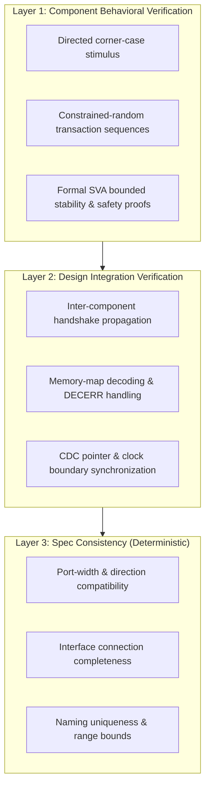
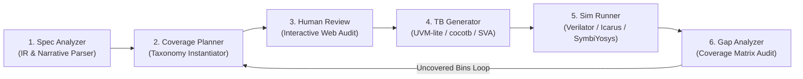

# Verification & Testplan System: Architecture & Implementation Plan

## 1. Executive Summary & Vision

In hardware SoC design, verification consumes **60–70% of total engineering effort**. While `spec2gds` provides deterministic specification editing and SystemVerilog skeleton generation (`rtl.generate`), hardware implementations require rigorous, coverage-driven verification before synthesis and tapeout.

This document distills the architecture, verification taxonomy, service design, and multi-stage implementation plan for the **spec2gds Verification & Testplan System**.

### Primary Objectives
1. **Human-Auditable Hierarchical Test Plans**: Bridge natural-language specification intent, architectural block diagrams, and register/port definitions into structured verification trees.
2. **Coverage-Driven Taxonomy**: Enforce 9 orthogonal verification categories with unique coverage bin IDs to prevent test overlap and redundant simulation cycles.
3. **Decoupled, Self-Contained Service (`testplan-service`)**: Standalone FastAPI service with thread-safe persistence, rich REST APIs, and an interactive browser-based editor matching the visual design language of **Circuit Designer** and **Spec Editor**.
4. **AI Assistant Integration Contract**: Stateless preview/apply proposal lifecycle allowing autonomous agents to inspect coverage gaps, propose new test nodes, and commit verified revisions atomically.
5. **Execution Roadmap**: From hierarchical test planning to automated testbench synthesis (UVM-lite, cocotb, and formal SVA proofs) and simulation gap closure.

---

## 2. Multi-Layer Verification Architecture

Verification operates across three hierarchical abstraction layers built bottom-up:



### Layer 1: Component Behavioral Verification (Highest Priority)
* **Scope**: Isolated functional validation of leaf hardware modules (ALUs, UARTs, FIFOs, arbiters).
* **Inputs**: Component port declarations, embedded SystemVerilog bodies (`EntitySectionIR`), and narrative design intent.
* **Outputs**: Per-component testbenches (cocotb / SystemVerilog) and SVA assertion suites.
* **Techniques**: Directed tests for boundary edge cases, constrained-random stimulus for data paths, and formal model checking for invariant stability.

### Layer 2: Design Integration Verification
* **Scope**: Multi-instance topological connectivity, backpressure handshakes, and bus protocol adherence.
* **Inputs**: Top-level design instances and ad-hoc / interface connections.
* **Outputs**: Top-level interconnect testbenches and end-to-end transaction latency checks.

### Layer 3: Spec Consistency Verification
* **Scope**: Static validation of the specification package itself.
* **Inputs**: Full `.spec` package.
* **Outputs**: Deterministic preflight consistency reports (zero LLM hallucination).

---

## 3. Coverage-Driven Taxonomy (The 9 Core Categories)

To prevent test duplication and ensure comprehensive verification coverage, every node in a testplan is mapped to an explicit coverage category:

| # | Category ID | Verification Focus | Example Target Coverage Bins |
|---|---|---|---|
| 1 | `port_boundary` | Min, max, zero, all-ones values on ports | `boundary:data_in:max_overflow`, `boundary:address:aperture_limit` |
| 2 | `reset_behavior` | Synchronous / asynchronous reset assertion & release | `reset:rst_n:all_registers_cleared`, `reset:recovery_latency` |
| 3 | `functional_mode` | Normal operational states and ALU opcodes | `mode:alu:sra_signed`, `mode:uart:fifo_bypass` |
| 4 | `protocol_compliance` | Bus handshakes, valid/ready pairs, AXI/APB rules | `protocol:axi:zero_wait_state_read`, `protocol:handshake:hold_valid` |
| 5 | `error_injection` | Underflow, overflow, parity/framing errors, illegal inputs | `error:fifo:underflow_read_blocked`, `error:uart:framing_error_pulse` |
| 6 | `timing_sequencing` | Back-to-back operations, pipeline stalls, CDC latency | `timing:cdc:asymmetric_ratio_4x`, `timing:pipeline:stall_hazard` |
| 7 | `cross_port` | Simultaneous transactions across multiple interfaces | `cross_port:simultaneous_rw_full`, `cross_port:dual_channel_skew` |
| 8 | `structural_connectivity` | Net traversal, unmapped apertures, bus routing | `connectivity:crossbar:unmapped_decerr`, `connectivity:fanout_check` |
| 9 | `special_patterns` | Walking ones, alternating bits (0xAA/0x55), stress patterns | `pattern:data:walking_ones_sweep`, `pattern:shifter:max_31bit_shift` |

### Overlap Prevention Algorithm
1. **Canonical Bin Uniqueness**: Every testcase defines one or more specific `coverage_bins` (e.g. `boundary:add:pos_overflow`).
2. **Deduplication Audit**: The testplan manager detects and flags duplicate coverage bins across different test cases.
3. **Intent Differentiation**: Stimulus and expected outcome criteria must be distinct; multiple tests targeting the exact same bin must justify different operational methodologies (e.g., directed edge case vs. random stress).

---

## 4. `testplan-service` Architecture

The `testplan-service` is implemented as an independent Python package under `testplan-service/` that interacts with the rest of `spec2gds` via clean HTTP boundaries:

```
testplan-service/
├── pyproject.toml              # Declarative package dependencies (FastAPI, Pydantic, httpx, pytest)
├── src/testplan_service/
│   ├── constants.py            # Hoisted constants, ports (6016), prefixes, constraints
│   ├── exceptions.py           # Precise typed domain exceptions
│   ├── logging.py              # Structured JSON event logging
│   ├── models/                 # Single-responsibility data models
│   │   ├── enums.py            # NodeKind, Category, Status, Priority, Stage, Methodology
│   │   ├── node.py             # TestPlanNode (hierarchical tree node)
│   │   ├── testplan.py         # TestPlanDocument (canonical schema root)
│   │   ├── operations.py       # BatchOperation & ProposalArtifact
│   │   └── summary.py          # TestPlanSummary metrics aggregator
│   ├── storage/                # Thread-safe persistence abstraction
│   │   ├── interface.py        # Abstract TestPlanRepository protocol
│   │   ├── memory_repository.py# In-memory test repository
│   │   └── file_repository.py  # Atomic JSON disk repository (.testplans/*.json)
│   ├── service/                # Core business logic
│   │   ├── manager.py          # TestPlanManager (cycle prevention, tree moves, CRUD)
│   │   ├── proposal_handler.py # AI Assistant preview & atomic apply
│   │   └── export_service.py   # Markdown & canonical JSON serializers
│   ├── api/                    # FastAPI routes & HTTP middleware
│   │   ├── app.py              # App factory, CORS, exception handlers, static mount
│   │   ├── routes_testplans.py # /api/v1/testplans (CRUD, duplicate, summary)
│   │   ├── routes_nodes.py     # /api/v1/testplans/{id}/nodes (CRUD, move, batch)
│   │   ├── routes_assistant.py # /assistant/* & /documents contract
│   │   └── routes_export.py    # /api/v1/testplans/{id}/export (Markdown/JSON)
│   ├── samples/                # Pre-built realistic domain testplans
│   │   ├── alu_plan.py         # RISC-V 32-bit ALU verification plan (21 nodes)
│   │   ├── uart_plan.py        # UART 16550 controller verification plan (19 nodes)
│   │   ├── fifo_plan.py        # Dual-clock asynchronous FIFO plan (15 nodes)
│   │   ├── crossbar_plan.py    # AXI4-Lite 1x4 crossbar interconnect plan (15 nodes)
│   │   └── seed.py             # CLI seeder utility
│   ├── ui/static/              # Responsive Web Editor matching Circuit Designer
│   │   ├── index.html          # Semantic HTML layout
│   │   ├── styles.css          # Circuit Designer palette (warm sage, paper, spruce teal)
│   │   └── app.js              # Live tree rendering, inspector, filter, diff preview
│   └── cli.py                  # Standalone CLI entrypoint (`testplan-service`)
└── tests/                      # 48 integration & unit tests
```

---

## 5. Visual Design & Circuit Designer Cohesion

To provide a consistent user experience across the `spec2gds` workspace, `testplan-service` uses the exact design system and color palette of **Circuit Designer** and **Spec Editor**:

* **Canvas Surface**: Warm light-sage background (`#ecefeb`) providing soft visual ergonomics.
* **Cards & Inspection Panels**: Pure white paper (`#ffffff`) with clean separation borders (`#d8ddd9` standard, `#b7bdb9` strong).
* **Brand & Accent**: Deep spruce teal mark (`#173d34` with `⚡` icon) and primary action buttons in forest teal (`#246b5a` with hover `#195345`).
* **Visual Status Stripes**: Every tree card features an immediate left-edge indicator bar:
  * **Passed / Proven**: `#276b4a` text on `#dff0e7` surface (border `#a9dcc4`)
  * **Failed / Error**: `#9b3128` text on `#f8dfdc` surface (border `#e8b7b2`)
  * **In Progress / Pending**: `#7e5a0d` text on `#fbefcd` surface (border `#e8d49a`)
  * **Planned / Idle**: `#58605c` text on `#e7ebe8` surface (border `#ced4cf`)
* **Typography**: Clean `Inter` / system-ui typography paired with `"IBM Plex Mono"` for hardware signal expressions, register addresses, and coverage bin tokens.

---

## 6. AI Assistant Protocol Contract

The service implements the unified AI Assistant contract shared with Spec Editor and Circuit Designer:

1. **Discovery (`GET /documents`)**: Returns metadata and active revisions of available testplans.
2. **Context Injection (`GET /assistant/context?document_id=...`)**: Returns structured JSON summaries and Markdown representations suitable for injection into LLM prompt contexts.
3. **Safe Proposal Preview (`POST /assistant/proposals/preview`)**:
   * Evaluates proposed batch operations (`add_node`, `update_node`, `delete_node`, `move_node`).
   * Validates parent references, cycles, and schema boundaries without mutating document state.
   * Emits unified color-coded diffs and diagnostics.
4. **Atomic Apply (`POST /assistant/proposals/apply`)**:
   * Executes verified operations inside an atomic transaction.
   * Advances the document revision count (`revision = revision + 1`).
   * Persists changes to disk and notifies connected UI clients.

---

## 7. Multi-Agent Verification Loop (Future Architecture)

For autonomous testcase generation and gap closure, the system defines a 6-agent cooperative pipeline:



1. **Spec Analyzer**: Extracts ports, clock/reset semantics, and narrative intent from the `.spec` IR.
2. **Coverage Planner**: Generates non-overlapping candidate testcases across the 9 categories.
3. **Human Review**: Engineer inspects, amends, or approves testplan proposals via the Web UI.
4. **Testbench Generator**: Emits executable cocotb or SystemVerilog testbenches matching testcase stimulus/expected outcome contracts.
5. **Simulation Runner**: Executes tests against generated RTL using open-source engines (`verilator`, `symbiyosys`, `cocotb`).
6. **Gap Analyzer**: Ingests simulation coverage databases, updates testcase statuses, and re-prompts the Coverage Planner for uncovered bins.

---

## 8. Implementation Roadmap

### Phase 1: Service Foundation & Core Architecture (Completed)
- [x] Canonical domain models with Pydantic validation and serialization.
- [x] In-memory and atomic JSON file repository persistence.
- [x] Hierarchy tree manager with strict cycle detection and subtree relocation.
- [x] REST API endpoints (`/api/v1/testplans`, `/api/v1/nodes`, `/api/v1/export`).
- [x] AI Assistant preview and apply proposal contract handlers.
- [x] Markdown and JSON document exporters.

### Phase 2: Domain Reference Plans & UI Styling (Completed)
- [x] 4 realistic domain verification plans (RISC-V ALU, UART 16550, CDC FIFO, AXI4-Lite Crossbar).
- [x] CLI entrypoint and `--seed` automated data loader.
- [x] Interactive browser UI with tree canvas, filter/search, and node inspector.
- [x] Color scheme and brand styling alignment with Circuit Designer (`#ecefeb`, `#246b5a`).
- [x] Integration into root repository dependencies and `uv sync` lockfiles.
- [x] 48-test automated test suite (100% pass rate).

### Phase 3: Ergonomic Enhancements (Near-Term)
- [ ] **Dual-View Switcher**: Toggle between the Hierarchy Tree and a sortable **Traceability Matrix Table View**.
- [ ] **Milestone Board**: Swimlane / Kanban layout grouping testcases by milestone stage (`V0 Smoke`, `V1 Core`, `V2 Corner`, `V3 Stress`).
- [ ] **Executive Progress Strip**: Multi-color segmented progress bar (Passed / In Progress / Failed / Planned) in the header.

### Phase 4: Verification Generation Engine (Medium-Term)
- [ ] Automated extraction bridge from `spec2gds.agent_spec.spec_format.ir` into initial testplan templates.
- [ ] Prompt templates for LLM-driven stimulus and expected outcome generation.
- [ ] SystemVerilog Assertion (SVA) generator for bus protocol invariants.

### Phase 5: Simulation Execution & Closed-Loop Closure (Long-Term)
- [ ] Simulation runner harness executing `cocotb` testbenches against generated RTL.
- [ ] Coverage database ingestion (UCDB / JSON coverage reports).
- [ ] Autonomous loop updating test statuses and closing coverage holes.

---

## 9. Quick Start & Verification Reference

### Run the Test Suites
```bash
# Run testplan generator verification tests
uv run python -m pytest testplan-service/tests/test_plan_generators.py -v

# Run the complete testplan-service test suite (48 tests)
uv run python -m pytest testplan-service/tests -v
```

### Seed Sample Testplans into Storage
```bash
uv run python -m testplan_service.samples.seed --storage-dir .testplans
```

### Launch the Interactive Web Service
```bash
# Launch on port 6016 (matching spec2gds services convention)
uv run testplan-service --host 0.0.0.0 --port 6016 --storage-dir .testplans
```
Open **`http://127.0.0.1:6016`** in any web browser to explore, audit, and manipulate the testplans.
