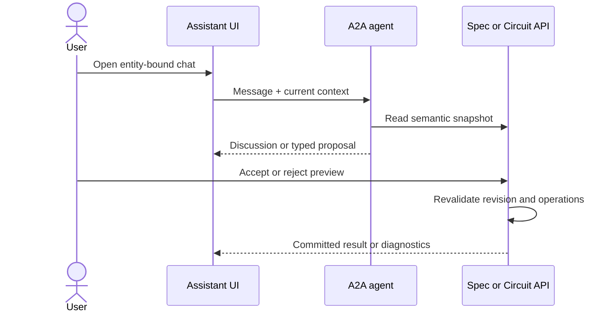

# Optional external assistant

This local application provides entity-bound conversations and reviewed change
proposals for the Spec Editor and Circuit Designer. Both editors remain fully
usable when it is stopped.

## Run

Requirements: Python 3.12+, `uv`, Node.js 24+, npm, and at least one owning
editor service.

```bash
uv sync
cd web
npm install
npm run build
cd ..

export OPENAI_API_KEY="..."
uv run spec2gds-external-assistant
```

Open <http://127.0.0.1:4200>. For frontend development, run `npm run dev` in
`web/` and open <http://127.0.0.1:4201>.

The default model is `gpt-4o-mini`; override it with `OPENAI_MODEL`. The local
SQLite database defaults to `data/assistant.db`.

## Flow and safety



Conversation does not mutate source. A user must request a proposal and accept
its preview. The owning API performs the final revision and validation checks.

Circuit service URLs are limited to loopback HTTP. Spec service URLs must match
`SPEC_SERVICE_ALLOWLIST`, which defaults to the local port `8000` origins. The
reference deployment has no user authentication.

## Useful configuration

| Variable | Default |
| --- | --- |
| `OPENAI_MODEL` | `gpt-4o-mini` |
| `ASSISTANT_HOST` | `127.0.0.1` |
| `ASSISTANT_PORT` | `4200` |
| `ASSISTANT_DATABASE_PATH` | `data/assistant.db` |
| `CIRCUIT_REQUEST_TIMEOUT_SECONDS` | `30` |
| `SPEC_REQUEST_TIMEOUT_SECONDS` | `30` |
| `SPEC_SERVICE_ALLOWLIST` | local Spec API origins on port `8000` |

## Verify

```bash
uv run python -m pytest -q
cd web
npm run build
```

System boundaries and full sequences are documented in
[`../docs/architecture.md`](../docs/architecture.md) and
[`../docs/flows.md`](../docs/flows.md).
