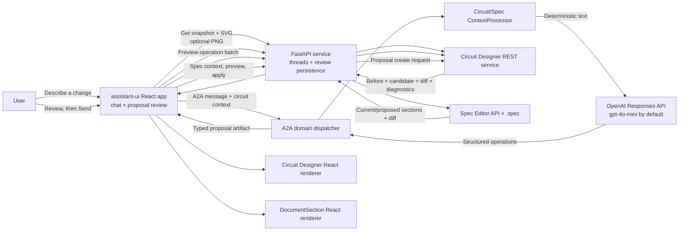

# External Assistant Architecture

The external assistant is an optional sibling of `circuit-designer`. It does
not change how Circuit Designer or Spec Editor starts or handles manual editing.
One domain dispatcher exposes independent Circuit and Spec skills.

## Responsibilities

### assistant-ui React application

- Owns the live chat experience and message composition.
- Lists, creates, archives, restores, and deletes persisted chats.
- Binds each chat permanently to one domain, service, document, and optional
  Spec entity.
- Retrieves the latest Circuit snapshot/SVG or Spec semantic context for every
  agent request.
- Receives typed A2A proposal artifacts.
- Displays the before/after proposal through `CircuitProposalDiffViewer`, which
  uses the same `@spec2gds/circuit-react` canvas as Circuit Designer.
- Sends a proposal to Circuit Designer only after the user chooses **Send to
  Circuit Designer**.
- Previews a Spec proposal with the shared `DocumentSection` renderer and
  applies it only after the user chooses **Approve and apply**.

### FastAPI service

- Persists chat metadata, assistant-ui history, A2A task state, and proposal
  review artifacts in one SQLite database.
- Proxies only explicit local Circuit Designer and allowlisted Spec operations.
- Enforces loopback HTTP service URLs and a configurable Spec origin allowlist.
- Checks the current revision before previewing or submitting/applying.
- Creates a pending Circuit Designer proposal, but forwards an approved Spec
  proposal to the Spec API for immediate revalidation and atomic application.

### A2A agent

- Publishes a standard A2A agent card and HTTP+JSON/JSON-RPC endpoints.
- Accepts user text plus either Circuit visual/semantic context or entity-bound
  Spec semantic context.
- Uses `ContextProcessor` as the extension seam for domain-to-text conversion.
- Produces either conversational Spec exploration text or a strict
  `circuit_change_proposal` / `spec_change_proposal` data artifact.

### Circuit Designer

- Remains authoritative for document validation, preview, diff, diagnostics,
  locks, revisions, and proposal state.
- Creates status, diagnostics, diff, and timestamps for submitted proposals.
- Continues to run independently when `external-assistant` is absent.

### Spec Editor

- Owns writable/read-only entity boundaries and legal references.
- Validates typed operations through `SpecEditTransaction`; model-authored XML,
  VLNV changes, assets, and cross-boundary edits are rejected.
- Atomically commits the approved source and accepted decision to `.spec`.
- Emits a source-change event after commit; its React UI shows a manual refresh
  notification and never silently replaces the displayed snapshot.

## Review model

Circuit has two explicit boundaries:

1. In the external assistant, the user reviews the proposed circuit change and
   chooses whether to send it.
2. In Circuit Designer, the submitted item is a normal pending proposal. Its
   existing Accept/Reject flow owns the actual document mutation.

This avoids granting an LLM or the external service direct commit authority.

Spec uses one explicit approval in the external UI. Preview is stateless; apply
repeats every check in the authoritative Spec API and is idempotent by proposal
ID plus operation digest.

## Chat ownership

assistant-ui owns the in-browser runtime behavior. The FastAPI history adapter
stores its messages and thread metadata, so chats survive browser and service
restarts. Bindings are immutable; every Spec launch intentionally creates a new
chat even for the same target. Older messages are summarized in SQLite while
the newest eight are sent verbatim.

## Extension points

- Derive another `ContextProcessor[T]` for a different domain.
- Implement another `AgentExecutor` and publish an additional A2A skill.
- Add another review artifact kind without changing Circuit Designer.
- Add authentication before allowing a non-loopback deployment. The reference
  setup intentionally permits loopback Circuit Designer URLs only.
